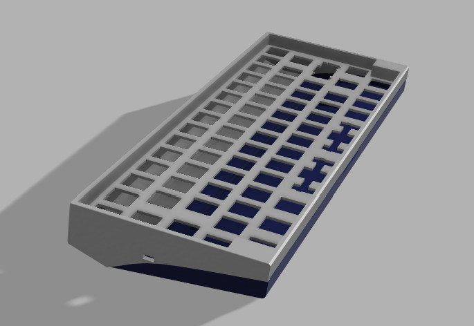
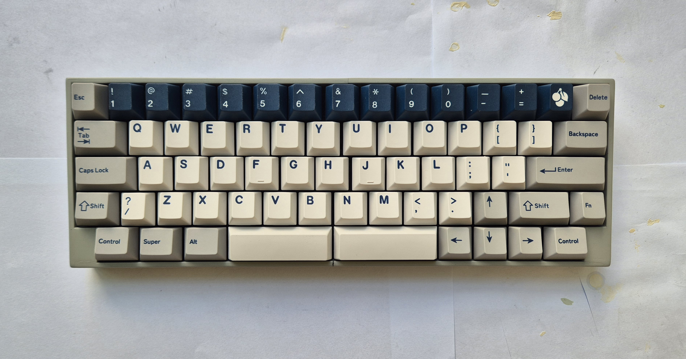
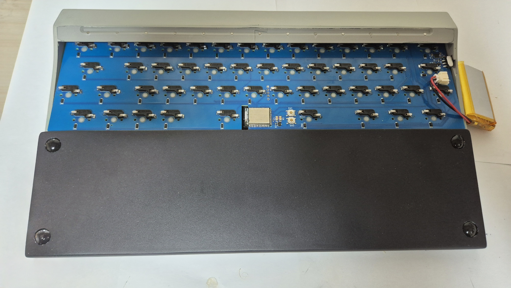

# Obscura60

Obscura60 is a custom 60% wireless mechanical keyboard, built as my first step into the world of custom keyboards.

Inspired by the compact layout of the Happy Hacking Keyboard (HHKB), it features a modified layout with dedicated arrow keys while retaining the overall simplicity of a 60% form factor.

The keyboard features a custom-designed PCB, a 3D-printed enclosure, and a wireless configuration based on ZMK firmware.

---

> [!WARNING]
> **Battery Circuit — Work in Progress**
>
> The battery charging and discharging circuit in the current hardware design is an unrevised version with known issues.
>
> The schematic and PCB documentation do not represent a finalized power management design. Do not use this circuit as a reference for building or connecting a Li-Po battery until the issues have been addressed and the design has been verified.

## Layout

The layout is based on the Happy Hacking Keyboard, with modifications to better suit my preferences.

It retains the compact arrangement of a traditional 60% keyboard while incorporating dedicated arrow keys for easier navigation.

## Specifications

| Item | Description |
|---|---|
| Form Factor | 60% |
| Layout | Modified HHKB |
| Key Matrix | 5 × 15 |
| Controller | Holyiot-18010 |
| MCU | Nordic nRF52840 |
| Connectivity | Bluetooth LE |
| Firmware | ZMK |
| Case | Custom 3D-printed |
| Battery | Li-Po |

## Hardware

### Controller

The keyboard uses the **Holyiot-18010**, a compact wireless module based on the Nordic nRF52840.

It handles keyboard matrix scanning and Bluetooth Low Energy communication through ZMK firmware.

### PCB

A custom PCB designed around the chosen layout and wireless configuration.

### Schematic

The circuit schematic documenting the keyboard's electrical connections.

> **Note:** The battery charging and discharging circuitry is not finalized. See the warning above.

## Case Design

The enclosure was designed specifically for the PCB and the overall 60% layout.

The case was manufactured using FDM 3D printing, allowing the dimensions and internal structure to be customized around the keyboard assembly.

### Housing Render

## Firmware

Obscura60 runs on [ZMK Firmware](https://zmk.dev/), an open-source firmware platform for wireless mechanical keyboards.

The keyboard-specific configuration, keymap, and build configuration are maintained in a separate repository.

**[Obscura60 ZMK Configuration](https://github.com/HNBN9/zmk-config-obscura60)**

## Build Gallery

Additional photos of the finished keyboard.

---

## License

This project uses separate licenses for software and non-software materials.

- **Firmware configuration and source code:** MIT License.
- **Hardware design files, documentation, photographs, and renders:** CC BY-NC 4.0.

See `LICENSE-MIT` and `LICENSE-CC-BY-NC` for the respective license terms.

---

