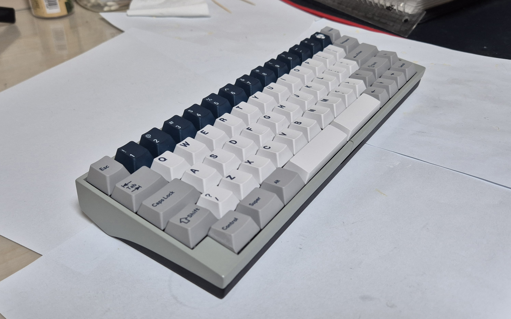
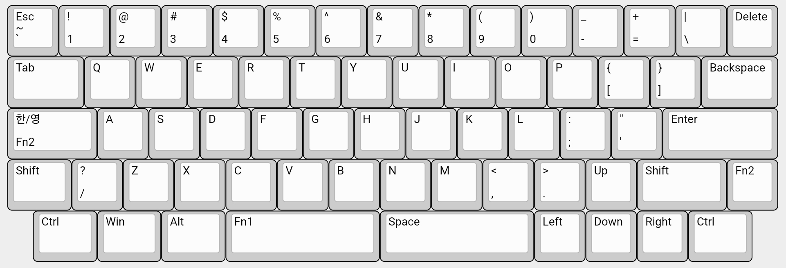
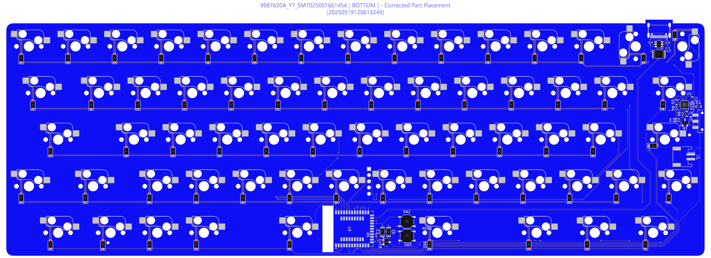
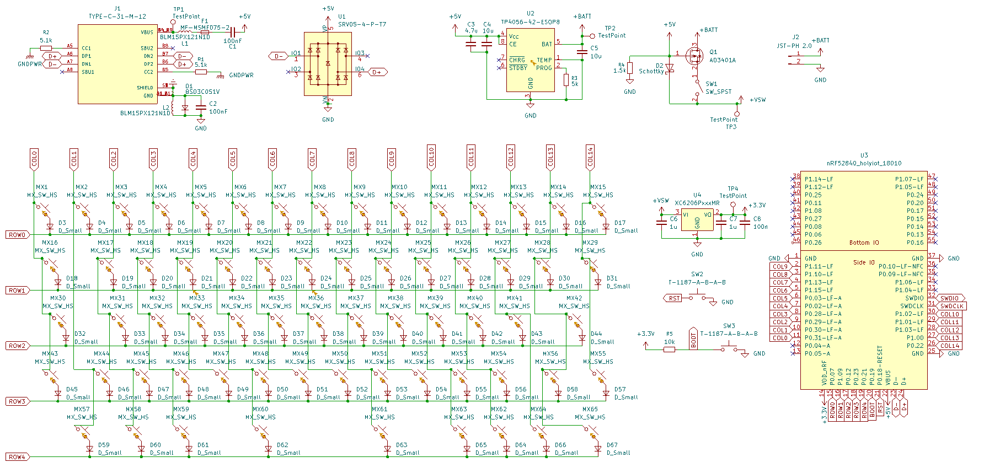

# Obscura60

Obscura60 is a custom 60% wireless mechanical keyboard, built as my first step into the world of custom keyboards.

## Concept

I wanted to keep typing on a compact 60% layout, which is what I'm most comfortable with. At the same time, I didn't want the keyboard to be a hassle for anyone else who sits at my desk.

So Obscura60 starts from the compact layout of the Happy Hacking Keyboard (HHKB) and adds dedicated arrow keys. It stays small and simple for me, but is still easy to use for someone who isn't used to a 60% keyboard.

It is built around a custom-designed PCB, a 3D-printed enclosure, and ZMK firmware over Bluetooth LE.

> [!WARNING]
> **Battery Circuit — Work in Progress**
>
> The battery charging and discharging circuit in the current hardware design is an unrevised version with known issues.
>
> The schematic and PCB files do not represent a finalized power management design. Do not use this circuit as a reference for building or connecting a Li-Po battery until the issues have been addressed and the design has been verified.

> [!WARNING]
> **Housing Dimension Error — Ctrl Key Position**
>
> Due to a measurement error in the housing design, a keycap does not fit at the Ctrl key position.
>
> The enclosure needs to be revised. Keep this in mind if you refer to the current case design.

## Features

- 60% compact layout (modified HHKB)
- Dedicated arrow keys
- Wireless connectivity over Bluetooth LE (Nordic nRF52840)
- Custom-designed PCB
- Custom FDM 3D-printed enclosure
- ZMK firmware

## Layout

The layout is based on the HHKB, modified to suit my own preferences. It keeps the compact arrangement of a traditional 60% keyboard and adds dedicated arrow keys, so that other people can use it comfortably without learning a new layout.

## Specifications

| Item | Description |
|---|---|
| Form Factor | 60% |
| Layout | Modified HHKB |
| Key Matrix | 5 × 15 |
| Controller | Holyiot-18010 |
| MCU | Nordic nRF52840 |
| Connectivity | Bluetooth LE |
| Firmware | ZMK |
| Case | Custom FDM 3D-printed |
| Battery | Li-Po (see the warning above) |

## Hardware

### Controller

The keyboard uses the **Holyiot-18010**, a compact wireless module based on the Nordic nRF52840. Together with ZMK firmware, it handles key matrix scanning and Bluetooth Low Energy communication.

### PCB

A custom PCB designed for this layout and wireless configuration.

### Schematic

The circuit schematic documenting the keyboard's electrical connections.

> [!NOTE]
> The battery charging and discharging circuitry is not finalized. See the warning above.

## Case Design

The enclosure was designed specifically for this PCB and the 60% layout. It was manufactured with FDM 3D printing, which allowed the dimensions and internal structure to be tailored to the keyboard assembly.

## Firmware

Obscura60 runs on [ZMK Firmware](https://zmk.dev/), an open-source firmware platform for wireless mechanical keyboards.

The keyboard-specific configuration, keymap, and build settings are maintained in a separate repository:

**[Obscura60 ZMK Configuration](https://github.com/HNBN9/zmk-config-obscura60)**

## Known Issues

- The battery charging and discharging circuit has known issues and has not been revised or verified.
- The published schematic and PCB should therefore be treated as a reference for the rest of the design only, not for the power circuit.
- The housing has a dimensional error at the Ctrl key position, where a keycap does not fit. The enclosure needs to be revised.

## Gallery

## References

- [ZMK Design Guide (ebastler)](https://github.com/ebastler/zmk-designguide) — referenced for the wireless keyboard PCB design, including the USB connector and protection circuitry.

## License

This project uses separate licenses for software and non-software materials.

| Material | License |
|---|---|
| Firmware configuration and source code | [MIT License](./LICENSE-MIT) |
| Hardware design files (schematic, PCB, case), documentation, photographs, and renders | [CC BY-NC 4.0](./LICENSE-CC-BY-NC) |

ZMK Firmware itself is distributed under its own license; see the [ZMK repository](https://github.com/zmkfirmware/zmk).
